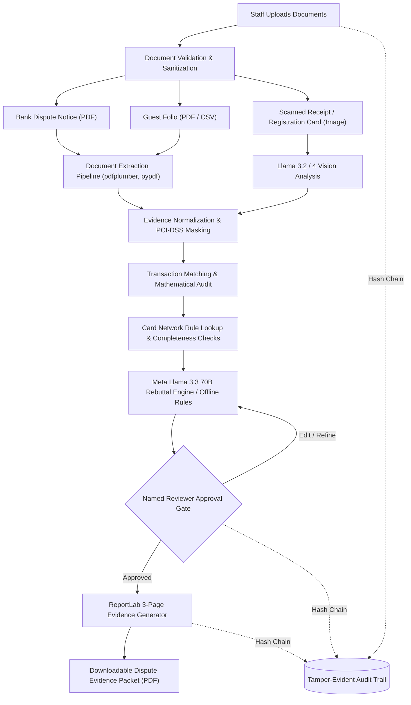
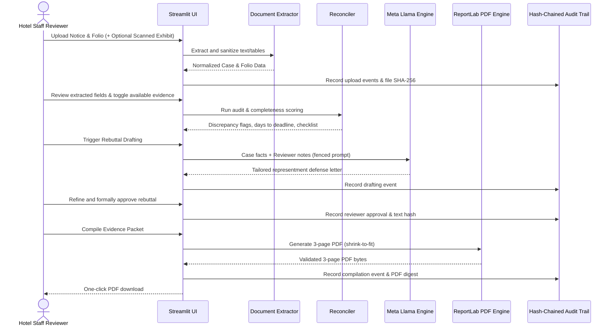

# 🛡️ FolioShield: Autonomous Chargeback Defense & Evidence Builder

> **Meta Llama Hackathon Submission** — Track: Build for Your World

FolioShield is an AI-powered financial defense engine designed to help hotels respond to credit card chargebacks by turning unstructured bank dispute notices and guest transaction records into organized dispute evidence packets.

Operating with an **outside-in, document-first approach**, FolioShield requires no direct integration with legacy Property Management Systems (PMS). It uses Meta Llama models to extract relevant information, analyze supporting evidence, draft dispute rebuttals, and generate a downloadable, three-page PDF evidence packet.

## 🎯 The Problem

Hotels can lose legitimate revenue when chargeback disputes are not handled promptly or when supporting documentation is incomplete, difficult to locate, or poorly organized.

Key challenges include:

- 💸 **Revenue Leakage:** Billing discrepancies, uncollected balances, and unsuccessful chargeback responses can affect hotel profitability.
- ⏱️ **Missed Deadlines:** Busy back-office teams may struggle to gather evidence and submit responses before processor deadlines.
- 🔌 **Disconnected Legacy Systems:** Hotel operations often involve multiple systems, making manual reconciliation time-consuming.
- 📄 **Fragmented Evidence:** Relevant receipts, transaction records, cancellation policies, and check-in documentation may be stored in different formats.

FolioShield addresses these challenges by automating document processing, evidence organization, and the preparation of dispute response materials.

## ✨ Key Features

### 📄 1. Zero-Integration Document Ingestion

Upload bank dispute notices and guest folios without requiring direct API access to Oracle OPERA, other PMS platforms, or payment gateways.

**Supported input formats:**
- Bank dispute notices: PDF
- Guest folios and receipts: PDF, CSV, and supported images

### 👁️ 2. Multimodal Evidence Extraction

Use Meta Llama 3.2 Vision to help interpret scanned receipts, registration documents, and other supported visual records.

The extraction pipeline identifies relevant information, such as transaction amounts, dates, reference numbers, and supporting evidence.

### ⚖️ 3. Card-Network-Aware Rebuttal Drafting

Use Meta Llama 3.3 70B to analyze dispute information and draft structured rebuttals tailored to the reported dispute reason.

Potential inputs include:
- Dispute reason codes
- Transaction and payment details
- Guest folios and itemized receipts
- Check-in and check-out records
- Cancellation and refund policies
- Other available supporting documentation

**Important:** Generated rebuttals are drafts for human review, not guaranteed legal advice or confirmation of compliance with card-network rules. Reason codes and evidence requirements must be validated against the applicable processor and current network documentation.

### 🔌 5. API-Based & Python Library Integration (BMS / PMS)

In addition to the interactive web portal, FolioShield provides a **direct Python SDK library** and a **zero-dependency REST API server** to integrate directly with existing Building Management Systems (BMS), Property Management Systems (Oracle OPERA, Cloudbeds, Mews), accounting ERPs, and automated dispute webhooks.

- **Python SDK (`FolioShield`)**: Embed FolioShield inside existing backend services with typed `NoticeData` and `FolioData` schemas.
- **REST API Server (`core.api`)**: Headless endpoints for automated reconciliation, rebuttal drafting, and 3-page PDF generation.

### 📑 4. One-Click PDF Evidence Packet

Generate a downloadable, three-page dispute evidence packet using ReportLab.

The proposed packet includes:
- A structured dispute cover letter
- An itemized transaction audit
- Relevant check-in timestamps and transaction details
- Supporting cancellation or refund policy evidence
- A summary of the available evidence and missing information

The packet is designed to help staff prepare a response for submission through their bank or payment processor. Actual submission remains subject to the processor's requirements and human review.

## 🏗️ Architecture & Pipeline



### End-to-End Sequence



### Pipeline Components

| Component | Responsibility | Technology |
|---|---|---|
| Document ingestion | Accept and validate uploaded files | Streamlit |
| PDF extraction | Extract text and document content | `pdfplumber`, `pypdf` |
| Structured data processing | Normalize transactions and compare records | `pandas` |
| Visual document interpretation | Analyze supported scanned documents | Meta Llama 3.2 Vision |
| Rebuttal generation | Draft evidence-based dispute responses | Meta Llama 3.3 70B |
| Evidence validation | Identify mismatches and missing information | Python validation rules |
| PDF generation | Produce the final evidence packet | ReportLab |

## 🔄 End-to-End Workflow

1. **Upload:** The user uploads a bank dispute notice and the relevant guest folio or receipt.
2. **Extract:** The system extracts available transaction details and document text.
3. **Interpret:** Vision capabilities help process supported scanned or image-based evidence.
4. **Reconcile:** The system compares transaction amounts, dates, identifiers, and other relevant fields.
5. **Evaluate:** Validation rules identify inconsistencies, missing documents, and unsupported claims.
6. **Draft:** The language model generates a rebuttal using the extracted facts and applicable dispute requirements.
7. **Review:** A staff member verifies the evidence, factual claims, and final response.
8. **Generate:** The system produces a downloadable PDF evidence packet.

## 🛠️ Tech Stack

### AI Models
- **Meta Llama 3.3 70B:** Text reasoning and rebuttal drafting.
- **Meta Llama 3.2 Vision:** Multimodal document interpretation.

### Frontend
- **Streamlit:** Document uploads, evidence review, workflow controls, and downloads.

### Data and Document Processing
- **Python 3.12**
- **pandas:** Structured data processing and reconciliation.
- **pdfplumber:** PDF text and table extraction.
- **pypdf:** PDF reading and document operations.

### PDF Generation
- **ReportLab:** Evidence packet creation and formatting.

## 🔐 Security, Reliability & Responsible AI

FolioShield processes financial and potentially sensitive guest information. A production implementation should include:

- Secure file validation and temporary-file handling.
- Access controls and least-privilege permissions.
- Encryption in transit and at rest.
- Configurable retention and deletion policies.
- Protection against malicious instructions embedded in uploaded documents.
- Validation of extracted amounts, dates, and transaction identifiers.
- Clear separation between source evidence and AI-generated text.
- Human approval before a rebuttal is submitted.
- Audit logs for document processing, edits, approvals, and packet generation.

The system must not invent evidence, fabricate signatures, or present unsupported statements as established facts. Missing information should be explicitly identified.

## 🚀 Getting Started

### Prerequisites

- Python 3.12
- Access to a compatible Meta Llama model inference provider
- The required model access credentials, where applicable

### Installation

Clone the repository:

```bash
git clone https://github.com/SaikumarBollam/FolioShield.git
cd FolioShield
```

Create and activate a virtual environment:

```bash
python -m venv .venv
```

Windows PowerShell:

```powershell
.venv\Scripts\Activate.ps1
```

macOS or Linux:

```bash
source .venv/bin/activate
```

Install the core dependencies:

```bash
pip install -r requirements.txt
```

### Configuration (`.env`)

Copy the environment template to create your active `.env`:

```bash
cp .env.example .env
```

Configure variables based on your deployment mode:

| Variable | Testing Mode (`ENVIRONMENT=testing`) | Production Mode (`ENVIRONMENT=production`) |
|---|---|---|
| `ENVIRONMENT` | `testing` | `production` |
| `LLAMA_PROVIDER` | `mock` (Offline deterministic rules, zero keys needed) | `groq`, `together`, or `openrouter` |
| `GROQ_API_KEY` | *(optional)* | `gsk_...` |
| `ENABLE_TEST_SCENARIOS` | `true` (Shows scenario quick-loader) | `false` (Direct intake for real dispute notices) |
| `SHOW_DEBUG_DETAILS` | `true` (Inspect raw OCR & regex text) | `false` (Clean front-desk staff view) |
| `MAX_UPLOAD_SIZE_MB` | `10` | `10` |

### Running the Application

Launch the Streamlit web application:

```bash
streamlit run app.py
```

Run automated tests across the entire pipeline:

```bash
python -m unittest discover tests
```

> **Implementation note:** These commands establish the initial environment. A complete runnable application also requires the application source files, model-provider integration, and any additional dependencies used by the implementation.

## 🗺️ Roadmap

- [x] Implement document upload and validation.
- [x] Extract structured transaction information from PDFs and CSV files.
- [x] Integrate Meta Llama 3.2 Vision for supported scanned documents.
- [x] Integrate Meta Llama 3.3 70B for evidence-based rebuttal drafting.
- [x] Add transaction reconciliation and evidence completeness checks.
- [x] Implement the three-page PDF evidence packet.
- [x] Add human review and approval controls.
- [x] Add secure file handling, audit logging, and automated tests.
- [ ] Validate generated packets against real processor submission requirements.

## 📊 Success Metrics

Evaluate the system using measurable operational and quality indicators:

- **Extraction accuracy:** Percentage of required fields correctly extracted.
- **Reconciliation accuracy:** Percentage of transaction mismatches correctly identified.
- **Evidence completeness:** Percentage of required evidence items available before submission.
- **Draft factuality:** Percentage of generated factual claims supported by source documents.
- **Processing time:** Time from document upload to review-ready packet.
- **Human correction rate:** Percentage of generated fields or statements requiring correction.
- **Deadline compliance:** Percentage of disputes prepared before their applicable deadlines.

These metrics should be measured against a representative, human-verified test dataset before making performance claims.

## ⚖️ Disclaimer

FolioShield is an evidence preparation and decision-support tool. It does not guarantee chargeback reversals, legal compliance, or acceptance of generated documents by banks, payment processors, or card networks.

All generated content should be reviewed by an authorized person before submission. Applicable deadlines, dispute reason codes, evidence requirements, and submission procedures must be verified with the relevant payment processor.

## 📄 License

This project is intended to use the MIT License. Include the corresponding `LICENSE` file in the repository before representing the project as officially licensed under MIT.
