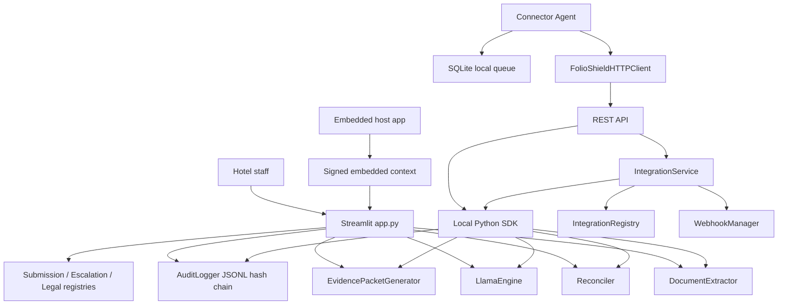

# 🛡️ FolioShield — Hotel Chargeback Defense & Evidence Management

FolioShield helps hotels respond to credit-card chargebacks by turning bank dispute notices, guest folios, and front-desk evidence into mathematically verified, evidence-backed dispute packets.

It follows an **outside-in, document-first workflow**: hotels do not need a direct PMS integration to get started. Staff can upload the documents they already have, review extracted facts, collect supporting evidence, approve a rebuttal, and generate a submission-ready packet. Enterprise integrations are available for hotels that want API, agent-based, or embedded delivery.

> **Current branch focus:** `feature/enterprise-readiness` — incremental enterprise architecture upgrade. See [Current-State Assessment](docs/architecture/current-state-assessment.md) for the verified baseline, gaps, risks, and migration sequence.

---

## What FolioShield does

FolioShield covers the chargeback lifecycle end to end:

| Phase | Capability |
|---|---|
| 1. Collection | Dispute-notice and folio extraction, claim statement, ARN/MID/AVS/3DS fields, file-backed evidence collection, submission gate |
| 2. Reconciliation | Folio footing, nights × rate recomputation, amount/card/name/date/settlement proofs |
| 3. Evidence Mapping | Per-reason-code evidence requirements with validators, including exact-amount POS-slip binding |
| 4. Rebuttal Drafting | Bank-expected five-section rebuttal with deterministic chronology and exhibit index |
| 5. Approval & Custody | Canonical approval fingerprint, hash-chained audit trail, case custody manifest |
| 6. Bank Submission | Submission ZIP bundle, acquirer portal profiles, pre-submission validation, decision tracking |
| 7. Second Chargeback | Prior-round snapshots, round diff, evidence-admissibility guidance |
| 8. Pre-Arbitration | Loss analysis, gap checklist, supplemental evidence round and rebuttal |
| 9. Arbitration | Fee / expected-value decision support with honest heuristic labelling |
| 10. Court / Legal Track | Business-records affidavit and witness/demand templates, damages, fraud report pack |

Enterprise expansion adds:

- Authenticated, tenant-scoped REST API integrations.
- Signed webhooks with delivery tracking and duplicate suppression.
- Authenticated Python HTTP SDK client.
- Outbound-only on-premises Connector Agent with durable local queue.
- Signed embedded context for host applications.
- Streamlit Integration Management for tenants, credentials, agents, webhooks, embedded configuration, and diagnostics.

---

## Interfaces

FolioShield provides three interfaces over the same processing engine. It does not maintain duplicate dispute-processing pipelines.

### 1. Streamlit application

Primary staff interface in [`app.py`](app.py):

1. Upload Notice & Guest Folio.
2. Stay & Billing Verification.
3. Dispute Response Letter.
4. Bank Submission.
5. Court / Legal Track.
6. Integration Management.
7. Staff Activity & History.

### 2. Python SDK

Local/headless SDK in [`core/client.py`](core/client.py):

- [`FolioShield`](core/client.py) — local extraction, reconciliation, drafting, PDF, submission, escalation, and legal helpers.
- [`FolioShieldHTTPClient`](core/client.py) — authenticated remote integration client with retries and idempotency headers.

### 3. REST API

REST API in [`core/api.py`](core/api.py):

- Legacy dispute endpoints are preserved for backward compatibility.
- Enterprise endpoints under `/api/v1/integrations/*` require Bearer integration credentials and are tenant-scoped.

See [API Integration](docs/integrations/api_integration.md) for the endpoint inventory.

---

## Architecture



### Core modules

| Area | Modules |
|---|---|
| Domain models | [`core/models.py`](core/models.py) |
| Extraction | [`core/extractor.py`](core/extractor.py) |
| Reconciliation | [`core/reconciler.py`](core/reconciler.py) |
| Evidence rules/validation | [`core/rules.py`](core/rules.py), [`core/evidence_validators.py`](core/evidence_validators.py) |
| AI drafting/vision | [`core/llm_engine.py`](core/llm_engine.py), [`core/rebuttal_validator.py`](core/rebuttal_validator.py) |
| Chronology | [`core/chronology.py`](core/chronology.py) |
| PDF generation | [`core/pdf_generator.py`](core/pdf_generator.py) |
| Audit/custody | [`core/audit_logger.py`](core/audit_logger.py), [`core/fingerprint.py`](core/fingerprint.py) |
| Evidence storage | [`core/exhibit_store.py`](core/exhibit_store.py) |
| Submission/escalation/legal | [`core/submission.py`](core/submission.py), [`core/escalation.py`](core/escalation.py), [`core/legal.py`](core/legal.py) |
| Integrations | [`core/integrations/`](core/integrations/) |
| Agent | [`agent/`](agent/) |
| Embedded | [`embedded/`](embedded/) |

---

## Tech stack

| Layer | Technology |
|---|---|
| Language | Python (production target: Python 3.12; verify before deployment) |
| Web UI | Streamlit |
| REST API | Python standard-library HTTP server today; production ASGI migration is planned/evaluated in the architecture roadmap |
| SDK | Python (`requests` for remote HTTP client) |
| Document extraction | `pdfplumber`, `pypdf`, `pandas`, Pillow |
| PDF generation | ReportLab |
| AI | Meta Llama-compatible APIs via Groq, Together AI, or OpenRouter; deterministic offline fallback |
| Configuration | `python-dotenv`, environment variables |
| Current persistence | JSON/JSONL registries, JSONL audit logs, content-addressed local evidence files, SQLite for the local agent queue |
| Planned persistence | PostgreSQL for structured data; local/S3-compatible object storage for documents |
| Testing | Python `unittest` |

Dependencies are listed in [`requirements.txt`](requirements.txt). PostgreSQL/SQLAlchemy/Alembic and production object-storage dependencies are **not yet introduced**; they are part of the enterprise upgrade roadmap.

---

## Getting started

### Prerequisites

- Python 3.12 recommended for production-target verification.
- Git.
- Optional: a Meta Llama provider API key for online drafting/vision. Offline/template mode works without a key.

### Install

```bash
git clone https://github.com/SaikumarBollam/FolioShield.git
cd FolioShield
python -m venv .venv
```

Windows PowerShell:

```powershell
.venv\Scripts\Activate.ps1
pip install -r requirements.txt
```

macOS/Linux:

```bash
source .venv/bin/activate
pip install -r requirements.txt
```

### Configure

```bash
cp .env.example .env
```

Important settings include:

| Variable | Purpose |
|---|---|
| `ENVIRONMENT` | `development`, `testing`, or `production` behavior |
| `LLAMA_PROVIDER` | `mock`, `groq`, `together`, or `openrouter` |
| `GROQ_API_KEY` / `TOGETHER_API_KEY` / `OPENROUTER_API_KEY` | AI provider credentials |
| `ENABLE_TEST_SCENARIOS` | Shows/hides built-in demo scenarios |
| `SHOW_DEBUG_DETAILS` | Shows/hides debug extraction views |
| `MAX_UPLOAD_SIZE_MB` | Upload size limit |
| `AUDIT_HMAC_KEY` | Optional HMAC protection for audit event hashes |
| `FOLIOSHIELD_INTEGRATION_ROOT` | Integration registry storage root |
| `FOLIOSHIELD_API_CORS_ORIGINS` | API CORS allowlist |
| `FOLIOSHIELD_API_MAX_BODY_MB` | API JSON body limit |
| `FOLIOSHIELD_EMBEDDED_*` | Embedded mode configuration |

Never commit a real `.env` file or secrets.

### Run the Streamlit app

```bash
streamlit run app.py
```

Open http://localhost:8501.

### Run the REST API

```bash
python -m core.api
```

Default local URL: http://localhost:8000

> The built-in API server is for development and controlled integration testing. Production deployment requires TLS termination, network controls, secret management, monitored storage, backups, and a production serving review. See [Integration Deployment](docs/integrations/deployment.md).

### Run the Connector Agent

```bash
python -m agent.agent --config agent.json --health
python -m agent.agent --config agent.json --once
```

See [On-Premises Agent](docs/integrations/on_premises_agent.md).

---

## Demo and manual test artifacts

Built-in demo scenarios are available from the Streamlit sidebar when test scenarios are enabled:

1. Visa 10.4 — False Fraud Claim.
2. Mastercard 4853 — Late Cancellation.
3. Amex C08 — Partial Incidentals.
4. Visa 10.4 — OTA Virtual Card.
5. Visa 13.6 — Refund Already Issued.
6. Mastercard 4859 — Post-Checkout Damage.

Upload-ready manual fixtures are under [`test_artifacts/manual_testing/`](test_artifacts/manual_testing/). Start with its [README](test_artifacts/manual_testing/README.md), choose **Custom Document Upload** in the app, and follow the selected scenario’s `TESTING_GUIDE.md`.

Regenerate fixtures with:

```bash
python data/generate_test_artifacts.py
```

---

## Testing

Run the full automated suite:

```bash
python -m unittest discover -s tests
```

Current verified baseline on `feature/enterprise-readiness`:

```text
Ran 125 tests
OK
```

Baseline environment note: the suite was executed locally on Python 3.15.2. Python 3.12 remains the production target and requires separate verification.

Test areas include extraction, reconciliation, evidence mapping, rebuttal drafting, custody/tamper detection, submission bundles, escalation, legal-track generation, API integration, authentication, tenant isolation, webhooks, agent reliability, and embedded context security.

---

## Security and responsible-use boundaries

FolioShield processes sensitive guest and payment-related information. Current controls include:

- PAN masking and prompt-injection sanitization.
- Upload type/size validation.
- File-backed evidence with SHA-256 hashes.
- Evidence validators that distinguish satisfied, weak, missing, and adverse evidence.
- Explicit human approval gates.
- Approval fingerprints and hash-chained audit logs.
- Tenant-scoped integration credentials with PBKDF2-hashed secrets.
- Signed webhooks and signed embedded context tokens.

Important limitations:

- Legacy REST endpoints are preserved for compatibility and must not be exposed publicly without network controls.
- Human-user enterprise authentication/RBAC and production OIDC/SSO are not yet implemented.
- Tenant isolation is implemented for enterprise integrations, but not yet across every Streamlit, submission, escalation, legal, audit, and evidence-storage path.
- PostgreSQL, production object storage, Docker deployment, retention automation, and production API serving are roadmap items, not current capabilities.
- FolioShield prepares submission bundles; hotel staff perform acquirer-portal uploads and record confirmations. It does not claim to auto-submit disputes to banks.
- AI-generated drafts are not source facts. They must remain traceable to validated evidence and receive human approval.
- Generated legal documents are templates for completion by the appropriate people and review by counsel; they are not legal advice or executed documents.

Do not claim PCI, SOC 2, GDPR, or other compliance certification based solely on these features.

---

## Documentation

| Document | Purpose |
|---|---|
| [Current-State Assessment](docs/architecture/current-state-assessment.md) | Verified architecture baseline, gaps, risks, migration sequence |
| [Operations Playbook](docs/PLAYBOOK.md) | Product consumption and operating paths |
| [Integration Architecture](docs/integrations/architecture.md) | API, agent, and embedded architecture |
| [API Integration](docs/integrations/api_integration.md) | REST endpoints and SDK notes |
| [On-Premises Agent](docs/integrations/on_premises_agent.md) | Connector Agent setup and behavior |
| [Embedded Integration](docs/integrations/embedded_integration.md) | Signed context and host integration |
| [Integration Security](docs/integrations/security.md) | Security controls and production requirements |
| [Integration Deployment](docs/integrations/deployment.md) | Deployment guidance and limitations |

---

## Roadmap

- [x] Document-first chargeback workflow.
- [x] Extraction, reconciliation proofs, and evidence mapping.
- [x] Five-section rebuttal drafting with chronology.
- [x] Human approval, fingerprinting, and hash-chained custody.
- [x] Submission bundles, portal profiles, and outcome tracking.
- [x] Escalation, pre-arbitration, arbitration decision support, and legal-track templates.
- [x] Tenant-scoped API, webhooks, Connector Agent, embedded context, and integration management.
- [ ] PostgreSQL persistence with SQLAlchemy/Alembic.
- [ ] Local/S3-compatible object-storage abstraction.
- [ ] Human-user OIDC/RBAC and platform-wide tenant isolation.
- [ ] Production API deployment with OpenAPI and readiness checks.
- [ ] Docker/Compose deployment, backup/restore, and data-migration tooling.
- [ ] Python 3.12 verification in CI/deployment.

---

## Disclaimer

FolioShield is an evidence-preparation and decision-support tool. It does not guarantee chargeback reversals, legal compliance, or acceptance of generated documents by banks, payment processors, card networks, courts, or law-enforcement agencies.

All generated content should be reviewed by an authorized person before submission. Deadlines, reason codes, evidence requirements, filing requirements, and submission procedures must be verified with the relevant processor, acquirer, network, court, or counsel.

## License

MIT — see [`LICENSE`](LICENSE).
