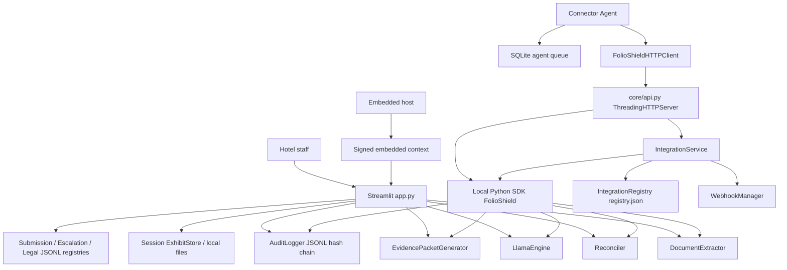

# FolioShield — Current-State Assessment

## Enterprise Architecture Upgrade, Phase 0

| Item | Value |
|---|---|
| Repository | `SaikumarBollam/FolioShield` |
| Branch | `feature/enterprise-readiness` |
| Commit inspected | `6f0fca890bdda430570650b27931eabfbdb49aba` |
| Assessment date | 2026-11-04 |
| Local interpreter | Python 3.15.2 |
| Requested production target | Python 3.12 (not yet verified) |
| Baseline test command | `.venv\Scripts\python.exe -m unittest discover -s tests -v` |
| Baseline result | **125 tests ran, all passed (`OK`) in 2.545s** |
| Working tree at inspection | Local commit `6f0fca8` is not yet pushed; untracked local `data/demo_integrations/`, `data/integrations/`, `package.json`, and `package-lock.json` exist. These are local/demo or unrelated files and must not be silently committed as production fixtures. |

> This assessment is based on the actual repository at the commit above. It distinguishes implemented behavior from documentation claims and from capabilities that require external validation.

---

## 1. Executive summary

FolioShield is currently a feature-rich modular monolith with three usable interfaces:

1. A Streamlit application for document-first hotel workflows.
2. A Python SDK for local/headless processing.
3. A REST API with legacy dispute endpoints and authenticated tenant-scoped integration endpoints.

The dispute domain is comparatively mature: collection, extraction, deterministic reconciliation proofs, evidence mapping/validation, rebuttal drafting/validation, approval fingerprinting, packet generation, submission bundles, escalation, and legal-track templates are implemented and covered by tests.

The commercial multi-tenant platform layer is incomplete:

- Structured operational data is stored primarily in JSON/JSONL files and Streamlit session state.
- PostgreSQL, SQLAlchemy, Alembic, object-storage abstraction, Docker, and production ASGI deployment do not exist yet.
- Human-user authentication and RBAC do not exist; existing bearer credentials are machine-to-machine integration credentials.
- Tenant isolation exists in the integration registry/service, but not across the Streamlit case workflow, submission/escalation/legal registries, evidence files, or audit trails.
- The REST API still uses Python `http.server` and exposes legacy unauthenticated endpoints.
- The local SDK’s `process_dispute()` records an `api_rebuttal_approved` event automatically, which conflicts with the enterprise rule that machine processing must not be represented as human approval. This must be corrected or explicitly versioned in a later phase without breaking SDK consumers silently.
- The README is materially stale relative to the implemented enterprise features and architecture.

The recommended path is an incremental strangler-style migration: introduce PostgreSQL repositories and object storage behind service boundaries, migrate integration/case data first, add human auth/RBAC, then move the API to a production ASGI deployment while preserving routes and SDK behavior.

---

## 2. Repository structure and architectural boundaries

### 2.1 Tracked structure

At inspection, tracked files are grouped as follows:

| Area | Count / contents |
|---|---|
| `app.py` | 1 Streamlit application, ~1,654 lines |
| `core/` | 27 tracked files, including integrations subpackage |
| `agent/` | 6 files |
| `embedded/` | 3 files |
| `data/` | Scenario/sample generators and scenario data |
| `docs/` | Playbook plus integration docs |
| `tests/` | 16 tracked files (15 test modules plus package marker) |
| `test_artifacts/` | 74 manual testing files |
| Root | README, requirements, `.env.example`, license, workflow PDF |

There is no `Dockerfile`, `docker-compose.yml`, `alembic.ini`, `pyproject.toml`, or production deployment manifest in the repository.

### 2.2 Current execution flow



### 2.3 Boundary assessment

**Strengths**

- The local SDK in `core/client.py` is a useful application facade over extraction, reconciliation, Llama drafting, PDF generation, submission, escalation, and legal helpers.
- The integration service in `core/integrations/service.py` delegates to the existing SDK rather than duplicating dispute logic.
- Domain rules are mostly outside HTTP handling: extractor, reconciler, evidence validators, rebuttal validator, chronology, fingerprint, submission, escalation, and legal modules are independently testable.
- Audit hashing, evidence hashing, and approval fingerprinting are reusable integrity primitives.

**Boundary problems**

- `app.py` is a very large UI/controller/persistence orchestrator. It owns session state, workflow gates, registry construction, file handling, audit calls, document generation, and integration management. It does not issue direct SQL today, but it does contain substantial application orchestration and some business decisions.
- `core/api.py` constructs services and a global SDK instance inside the HTTP module; integration requests construct new registry/service/engine objects per request.
- Several registries independently implement JSON/JSONL persistence with duplicated `_safe`, append/load, and path logic.
- Domain models are dataclasses/dicts without tenant ownership. Tenant context exists only in integration contracts.
- There is no repository layer, unit-of-work, transaction boundary, or dependency-injection container.
- Configuration is centralized for the original app in `core/config.py`, but integration/API/embedded/agent settings are scattered across environment reads in `core/api.py`, `embedded/configuration.py`, `agent/config.py`, and Streamlit.

---

## 3. Existing interfaces and API endpoints

### 3.1 Streamlit interface

The Streamlit app provides tabs for:

1. Upload Notice & Guest Folio.
2. Stay & Billing Verification.
3. Dispute Response Letter.
4. Bank Submission.
5. Court / Legal Track.
6. Integration Management.
7. Staff Activity & History.

It also supports scenario quick-loading, document review/correction, vision analysis, evidence collection/provenance, approval gates, packet preview/download, submission/outcome/escalation workflows, legal document generation, integration administration, and audit-chain display/export.

### 3.2 Python SDK

The local SDK class `FolioShield` preserves methods for:

- Notice/folio extraction, including OCR fallback.
- Reconciliation.
- Rebuttal drafting.
- PDF packet generation and hashed packet generation.
- Full dispute processing.
- Submission bundle/submission/outcome operations.
- Escalation/loss/arbitration helpers.
- Supplemental rebuttal.
- Damages, affidavit, and court bundle generation.

The additive `FolioShieldHTTPClient` supports authenticated remote integration calls, retries, idempotency headers, case/document/process/audit/monitoring operations, and webhook signature verification.

### 3.3 Legacy REST endpoints

These endpoints exist and must be preserved or compatibility-managed:

| Method | Route | Auth today | Notes |
|---|---|---|---|
| GET | `/health`, `/api/v1/health` | None | Returns environment/provider status and request ID. |
| POST | `/api/v1/reconcile` | None | Uses global SDK instance. |
| POST | `/api/v1/rebuttal/draft` | None | Uses global SDK instance. |
| POST | `/api/v1/packet/generate` | None | Caller supplies rebuttal/approved-by strings. |
| POST | `/api/v1/submission/bundle` | None | Base64 packet/exhibits; builds ZIP bundle. |
| POST | `/api/v1/submission/register` | None | Writes shared submission JSONL by case ID. |
| POST | `/api/v1/submission/outcome` | None | Writes shared submission JSONL by case ID. |
| POST | `/api/v1/dispute/process` | None | Full headless processing; records approval-style audit event automatically. |

### 3.4 Enterprise integration REST endpoints

These routes require Bearer integration credentials:

| Method | Route | Required scope / control |
|---|---|---|
| POST | `/api/v1/integrations/cases` | `cases:write`; property check when property IDs are constrained |
| GET | `/api/v1/integrations/cases` | Service requires `cases:read` |
| GET | `/api/v1/integrations/cases/{case_id}` | Service requires `cases:read` |
| POST | `/api/v1/integrations/cases/{case_id}/documents` | `documents:write` |
| POST | `/api/v1/integrations/cases/{case_id}/reconcile` | `cases:process` |
| POST | `/api/v1/integrations/cases/{case_id}/draft` | `cases:process` |
| POST | `/api/v1/integrations/cases/{case_id}/process` | `cases:process`; returns `approval: null` |
| POST | `/api/v1/integrations/cases/{case_id}/packet` | `packets:generate` plus explicit approval reference |
| GET | `/api/v1/integrations/cases/{case_id}/audit` | `audit:read` |
| GET | `/api/v1/integrations/monitoring` | Authenticated tenant context |
| GET | `/api/v1/integrations/agents` | Authenticated tenant context |
| POST | `/api/v1/integrations/agents/{agent_id}/heartbeat` | `agent:sync` |
| GET | `/api/v1/integrations/webhooks` | Authenticated tenant context |
| POST | `/api/v1/integrations/webhooks` | `webhooks:manage` |

### 3.5 Agent and embedded interfaces

- The connector agent uses outbound HTTPS through `FolioShieldHTTPClient`, a local SQLite queue, filesystem/REST connectors, heartbeat, and health output.
- Embedded mode uses HMAC-signed, short-lived context tokens validated server-side by `embedded/context.py`.
- OIDC/OAuth2 human SSO is not implemented and is correctly labelled as requiring identity-provider validation.

---

## 4. Authentication and authorization

### 4.1 Machine-to-machine integration authentication

Implemented in `core/integrations/authentication.py` and `core/integrations/registry.py`:

- Credential IDs are embedded in the raw secret prefix for lookup.
- Raw secrets are generated with `secrets` and shown once.
- Stored secrets use salted PBKDF2-HMAC-SHA256 with 210,000 iterations.
- Verification uses constant-time comparison.
- Credentials belong to one tenant and carry scopes, roles, property IDs, actor type/ID, status, creation/expiry/last-used/revocation metadata.
- Suspended/revoked/expired credentials and suspended tenants fail closed.
- Agent registration issues a scoped agent credential; heartbeat fails when the agent is not active.

Limitations:

- No credential rotation workflow that overlaps old/new credentials.
- No per-credential rate limits or anomaly detection.
- Credential records are stored in a JSON file, not a database.
- Property authorization is checked at case creation, but existing case payloads do not carry a consistently enforced property boundary for every later operation.
- Roles are carried on credentials/context but endpoint authorization is primarily scope-based; there is no unified RBAC policy engine.

### 4.2 Human-user authentication

There is no human-user account system:

- Streamlit asks for a free-text reviewer name and a role selected from a dropdown.
- Integration Management asks for a tenant ID and a self-attested authorization checkbox.
- Embedded mode validates a signed context token, but it does not implement a full OIDC login/session lifecycle.

This is not enterprise human authentication. A standards-based OIDC/OAuth2 integration or maintained auth library must be added in Phase 3. Custom password/session security should not be built from scratch.

### 4.3 Authorization model today

- Integration service methods call `TenantContext.require_scope(...)`.
- API integration routes authenticate before constructing `IntegrationService`.
- Streamlit approval requires a named reviewer and gate checks, but identity is not authenticated.
- Legacy REST endpoints have no authentication or authorization.

---

## 5. Tenant isolation

### 5.1 Implemented isolation

The integration registry partitions records by tenant:

- Tenants: keyed by sanitized tenant ID.
- Credentials: each record has `tenant_id`; revocation checks tenant ownership.
- Agents: keyed by `{tenant_id}:{agent_id}`.
- Cases: keyed by `{tenant_id}:{case_id}`.
- Jobs: keyed and filtered by tenant.
- Webhooks/deliveries: filtered by tenant.
- Monitoring snapshots are tenant-scoped.

Tests prove selected registry/service isolation behaviors, credential revocation ownership, and tenant suspension fail-closed behavior.

### 5.2 Isolation gaps

Tenant isolation is not platform-wide:

- `SubmissionRegistry`, `EscalationRegistry`, and `LegalRegistry` key files only by case ID under shared `data/submissions` roots.
- Audit logs are session-based JSONL files without tenant ownership fields as a first-class schema column.
- Streamlit session cases have no tenant/property ownership model.
- `ExhibitStore` keys objects only by SHA-256; identical content across tenants intentionally deduplicates to the same key, and there is no tenant authorization layer in the store itself.
- Case IDs are caller/bank identifiers, not globally unique tenant-owned UUIDs.
- Integration case payloads store full notice/folio/reconciliation/draft data inside one JSON registry payload rather than normalized relational records.
- Embedded context carries tenant/property/user claims, but Streamlit does not use that context to scope its existing case workflow or registries.

**Conclusion:** Tenant isolation is real but limited to the enterprise integration registry/service. It must be extended through repositories/services before commercial multi-tenant deployment.

---

## 6. Integration registry and webhooks

### 6.1 Registry implementation

`IntegrationRegistry` persists all integration state to one `registry.json` file:

```json
{
  "tenants": {},
  "credentials": {},
  "agents": {},
  "webhooks": {},
  "cases": {},
  "jobs": {},
  "deliveries": {}
}
```

Writes use a temporary file plus `os.replace`, and an in-process `threading.RLock` protects mutations. This is safer than naive overwriting, but it is not a multi-process or multi-instance database:

- Separate API processes can load stale state and overwrite each other.
- Every mutation rewrites the whole registry.
- Case payloads can make the file large and slow.
- No indexes, transactions across entities, foreign keys, or query planner exist.
- Backup/restore is file-copy based and undocumented for production.

The local inspected registry contains demo data: 1 tenant, 2 credentials, 1 agent, 0 webhooks, 1 case, 0 jobs, 0 deliveries. This data must be treated as local operational data, not committed as a production fixture.

### 6.2 Webhooks

`WebhookManager` implements:

- Tenant subscriptions and event filters.
- HMAC-SHA256 signatures over `timestamp.payload`.
- Timestamp tolerance verification.
- Event IDs and delivery IDs.
- `Idempotency-Key` header using the event ID.
- Duplicate suppression by `(subscription_id, event_id)`.
- Delivery records with attempts, status, last error, and next-attempt timestamp.
- Injectable sender for tests.

Gaps:

- Webhook subscription secrets are stored in plaintext inside `registry.json`. They are not raw API credentials, but they are signing secrets and should be encrypted or referenced through a secret store in production.
- Retries are synchronous inside `publish()` with computed backoff metadata; there is no durable background delivery worker that later resumes `retrying` deliveries.
- `IntegrationService._emit()` swallows webhook exceptions to protect dispute processing, but failures need operational alerting/monitoring.
- No subscription rotation workflow or delivery inspection API beyond listing through registry/UI data.

---

## 7. Audit and evidence storage

### 7.1 Audit logger

`AuditLogger` is a significant asset:

- Each event contains timestamp, session ID, action, actor, details, previous hash, and event hash.
- Hashes are SHA-256 over canonical JSON, or HMAC-SHA256 when `AUDIT_HMAC_KEY` is configured.
- `chain_head` anchors session ID, event count, head hash, and HMAC status.
- `verify_chain(expected_head=...)` detects edits, deletion/reordering, truncation, and rewrites when an anchored head is supplied.
- `load_and_verify()` re-reads JSONL files and verifies them.
- `build_case_manifest()` exports file hashes, approval data, packet data, and chain head.

Limitations:

- Events are session-scoped, not tenant/case-owned relational records.
- Actor is a free-text string in most workflows.
- Event schema is not versioned as a formal contract.
- Details are arbitrary dictionaries; sensitive-data redaction depends on callers.
- JSONL files accumulate per session and are not centrally queryable.
- A hash chain alone is tamper-evident, not independently immutable. External anchoring, WORM/object-lock storage, backups, and access controls would be needed for stronger claims.
- The API constructs fresh `FolioShield()` engines in several paths, creating separate audit sessions/loggers rather than one request/case-scoped audit context.

### 7.2 Evidence storage

`ExhibitStore` preserves SHA-256 content addressing:

- `put()` computes SHA-256, size, MIME-by-extension, and `stored_ref`.
- Disk layout is `<root>/<sha256[:2]>/<sha256><ext>` when a root is configured.
- In the Streamlit workflow it is primarily session/in-memory; generated bundles use retained bytes from session state.

Gaps:

- No storage abstraction interface with local/S3 implementations.
- No tenant/case ownership in storage keys or authorization checks.
- MIME is inferred from filename extension, not verified content type for every object.
- No signed URLs, authenticated streaming endpoint, retention status, deletion workflow, or lifecycle policy.
- No database document metadata record linking tenant/property/case/uploader/processing status to the object.
- Existing files must not be silently moved/deleted during migration.

### 7.3 Other persistence

| Mechanism | Current format | Used for | Main limitation |
|---|---|---|---|
| `IntegrationRegistry` | Single JSON file | Tenants, credentials, agents, webhooks, cases, jobs, deliveries | Whole-file rewrites; no multi-process safety |
| `SubmissionRegistry` | JSONL per case ID | Submissions and outcomes | No tenant key; case-ID collisions possible |
| `EscalationRegistry` | Same JSONL files | Stage history, snapshots, losses, arbitration | Shares files/roots with submission/legal registries by kind filtering |
| `LegalRegistry` | Same JSONL files | Witnesses and legal filings | No tenant key |
| `AuditLogger` | JSONL per session | Audit events | Not queryable; no tenant schema |
| `ExhibitStore` | Memory or content-addressed files | Evidence bytes | No ownership/authorization/retention |
| Agent queue | SQLite | Local agent jobs | Local only; appropriate for agent, not server DB |
| Streamlit state | In-memory session | Current case, evidence, drafts, bundles | Lost on restart; not multi-user system of record |
| Scenario/demo data | Python/JSON/files under `data/` | Tests and demos | Must remain separate from production tenant data |

---

## 8. Existing data formats relevant to migration

Migration design must handle these actual formats:

1. **Integration registry JSON** with top-level `tenants`, `credentials`, `agents`, `webhooks`, `cases`, `jobs`, and `deliveries` maps.
2. **Case JSONL entries** shaped as `{kind, recorded_at, record}`. Kinds observed across registries include `submission`, `outcome`, `stage`, `round_snapshot`, `loss`, `arbitration`, `witness`, and `legal_filing`.
3. **Audit JSONL events** shaped as `{timestamp, session_id, action, actor, details, prev_hash, event_hash}`.
4. **Agent SQLite `jobs` table** with job ID, type, JSON payload, status, attempts, idempotency key, error, and timestamps.
5. **Content-addressed evidence files** whose SHA-256 is both identity and integrity checksum.
6. **Domain payloads** based on `NoticeData`, `FolioData`, `EvidenceItem`, `SubmissionRecord`, `OutcomeRecord`, witness/legal records, reconciliation dictionaries, and integration contracts.

Identifiers are currently mixed: bank case IDs, caller-supplied integration case IDs, credential IDs, agent IDs, UUID job/event IDs, SHA-256 file IDs, and audit session IDs. PostgreSQL migration should preserve external identifiers while introducing UUID primary keys.

---

## 9. Test coverage and baseline

### 9.1 Executed baseline

Command:

```powershell
.venv\Scripts\python.exe -m unittest discover -s tests -v
```

Result at commit `6f0fca8`:

```text
Ran 125 tests in 2.545s
OK
```

Interpreter: Python 3.15.2.

### 9.2 Coverage by area

| Test module | Coverage |
|---|---|
| `test_pipeline.py` | Security masking, extraction, reconciliation, Llama fallback, PDF, config, SDK/API legacy dispatch |
| `test_phase1_collection.py` | Collection/extraction, gaps, OTA/refund, CE 3.0, OCR, search helper regression |
| `test_phase2_reconciliation.py` | Footing, amount, identity, dates, settlement, scope, PDF proofs |
| `test_phase3_evidence.py` | Evidence specs/validators, branching, exhibits |
| `test_phase4_rebuttal.py` | Five-section draft, chronology, validator, adverse evidence |
| `test_phase5_custody.py` | Fingerprint, tamper matrix, disk verification, manifest, SDK parity |
| `test_phase6_submission.py` | Exhibit store, bundles, portals, registry windows |
| `test_phase7_9_escalation.py` | Stage machine, gaps, arbitration, supplemental draft |
| `test_phase10_legal.py` | Damages, legal templates, fraud pack, court bundle |
| `test_integrations.py` | Credentials, service processing, scopes, HTTP client |
| `test_webhooks.py` | Signing, delivery, dedupe, revocation/filtering |
| `test_agent.py` | Queue durability/backoff, filesystem sync, SQL refusal |
| `test_embedded.py` | Signed context, expiry/tamper/origin, CSP config |
| `test_tenant_isolation.py` | Monitoring scope and agent suspension |
| `test_authentication.py` | Bearer registry auth and tenant suspension |

### 9.3 Test gaps for the target architecture

No tests currently cover:

- PostgreSQL, SQLAlchemy, Alembic, repositories, transactions, or rollbacks.
- Human-user login, OIDC, sessions, RBAC role matrix, or role changes.
- Cross-tenant document download/modification through every interface.
- Cross-tenant audit access.
- Object-storage S3 behavior, signed URLs, missing objects, or checksum-on-read.
- Production API framework behavior, OpenAPI contracts, rate limiting, or readiness checks.
- Concurrent registry/API writes across processes.
- Data migration idempotency, dry-run, reconciliation reports, or rollback.
- Python 3.12.
- Docker/Compose startup.
- Backup/restore.

---

## 10. Security and architecture gaps

### Critical

1. **Legacy API endpoints are unauthenticated.** They can process disputes and write submission/outcome records if network-reachable.
2. **No human authentication/RBAC.** Streamlit reviewer identity is self-asserted; Integration Management authorization is a checkbox.
3. **Tenant isolation is incomplete.** Submission/escalation/legal/audit/evidence/Streamlit data are not tenant-owned.
4. **Filesystem JSON is the primary server-side structured store.** This is explicitly unsuitable as the production relational system of record.
5. **SDK headless approval semantics conflict with enterprise rules.** `FolioShield.process_dispute` logs `api_rebuttal_approved` automatically. The newer integration service correctly refuses to fabricate approval. A compatibility plan is required: preserve the method, but version/correct the audit semantics and packet approval claims.

### High

6. **No PostgreSQL or migrations.** No SQLAlchemy, Alembic, psycopg, schema, FKs, indexes, pooling, or transaction boundaries.
7. **No object-storage abstraction.** Local exhibit storage is useful but not tenant-authorized or production-configurable; no S3 adapter.
8. **API production readiness.** `ThreadingHTTPServer` is improved over single-threaded HTTP but lacks production ASGI behavior, structured validation, OpenAPI, rate limiting, readiness checks, and a documented TLS serving topology.
9. **Configuration sprawl.** Original settings are centralized, but API limits/CORS/integration root, embedded settings, agent settings, and audit HMAC are read in multiple places.
10. **Webhook secrets are plaintext in the registry file.** Signing secrets need encryption, KMS/secret-manager references, or at minimum documented protected storage and rotation.
11. **Webhook retries are not a durable background process.** Delivery state exists, but retrying deliveries are not resumed by a worker.
12. **Audit events are not tenant-scoped or centrally queryable.** DB audit metadata must be added without replacing historical JSONL verification.
13. **No retention/secure-deletion/legal-hold model.** Evidence and audit retention are operational requirements, not implemented policies.
14. **No Docker or production deployment assets.** No Dockerfile, Compose, reverse-proxy example, backup/restore runbook, or health/readiness deployment checks.

### Medium

15. **README drift.** README describes the earlier hackathon product and does not document the current enterprise integrations, legal/escalation features, storage, or deployment boundaries.
16. **Large Streamlit controller.** `app.py` needs gradual service extraction; a rewrite would be risky and is not recommended.
17. **Registry code duplication.** Submission/escalation/legal registries duplicate JSONL append/load/path logic.
18. **Global SDK instance in legacy API.** `fs = FolioShield()` at module import shares engine/audit state for legacy routes.
19. **No structured logging standard.** Python logging exists, but request/correlation/tenant/actor fields are not consistently emitted.
20. **No dependency lock or Python 3.12 verification.** `requirements.txt` uses lower bounds only; local runtime is 3.15.2.
21. **Untracked local data.** Demo integration data and credentials exist locally under `data/demo_integrations/` and `data/integrations/`; they must be handled carefully and never committed with secrets.

---

## 11. Recommended migration sequence

### Phase 0 — Assessment (this document)

- Freeze the baseline: branch, commit, test result, endpoint inventory, data formats.
- Do not begin a major refactor until the database and API decisions are reviewed.

### Phase 1 — Persistence foundation

1. Extend `core/config.py` with PostgreSQL, pool, storage, auth/OIDC, session/token, audit, and integration settings.
2. Add SQLAlchemy 2.x, psycopg, and Alembic as documented dependencies.
3. Create `core/database/` for engine/session/transaction handling.
4. Design a practical normalized schema: organizations, properties, users/memberships/roles, disputes, documents, evidence, drafts, approvals, outcomes, integrations, webhooks, audit metadata.
5. Add repositories and service boundaries; keep existing SDK/API contracts stable.
6. Add PostgreSQL integration tests using a real database service in CI/local Compose.

### Phase 2 — Object storage

1. Introduce a storage interface preserving SHA-256 content addressing.
2. Implement local filesystem adapter compatible with `ExhibitStore` references.
3. Implement private S3-compatible adapter with safe keys, checksum verification, authenticated streaming or short-lived signed URLs.
4. Store document metadata in PostgreSQL; never store document binaries in PostgreSQL.
5. Build idempotent file migration tooling with checksum verification and reports.

### Phase 3 — Authentication and tenant security

1. Add standards-based human OIDC/OAuth2 integration using a maintained library/IdP configuration; do not build custom password/session security.
2. Implement organization/property membership and RBAC permissions.
3. Preserve machine bearer credentials for integrations; add rotation/revocation operations.
4. Make repositories tenant-aware by construction and add cross-tenant denial tests for disputes, documents, evidence, credentials, and audit records.
5. Evaluate PostgreSQL RLS only as defense in depth after transaction-scoped tenant context is tested with pooling.

### Phase 4 — Audit and integration persistence

1. Keep JSONL hash-chain compatibility and verification.
2. Add DB audit-event metadata indexed by tenant/actor/resource/request ID while preserving event hash/HMAC integrity fields.
3. Migrate integration registry, webhook subscriptions/deliveries, jobs, submissions, outcomes, escalation, and legal records into PostgreSQL repositories.
4. Add durable webhook retry processing and delivery inspection.
5. Produce migration reconciliation and rollback procedures.

### Phase 5 — Production API

1. Evaluate FastAPI against the existing stdlib handler. If adopted, preserve routes and response contracts, add validation/OpenAPI, authorization dependencies, correlation IDs, health/readiness, and production ASGI serving.
2. Keep the legacy stdlib API only as a development/compatibility option if needed; do not expose it directly to the public internet.
3. Add rate limiting at the API/gateway layer and structured errors.

### Phase 6 — Deployment and validation

1. Add Dockerfile and Docker Compose with PostgreSQL and local storage/S3-compatible development option.
2. Document TLS reverse proxy/ingress, backups, restore, migration, retention, and incident procedures.
3. Run full regression, security, migration, and Python 3.12 test suites.
4. Update README and architecture/security/deployment docs.
5. Publish a final implementation report separating implemented/tested, partial, not implemented, and externally blocked items.

---

## 12. Risk register

| ID | Risk | Impact | Mitigation |
|---|---|---|---|
| R-01 | JSON registry corruption or multi-process overwrite | Data loss, cross-tenant confusion | Move to PostgreSQL transactions; back up current files before migration |
| R-02 | Legacy API exposed publicly | Unauthorized dispute processing/data access | Network restriction now; authenticated production API; disable/protect legacy routes |
| R-03 | Tenant isolation bypass through shared JSONL/case IDs | Cross-hotel data exposure | Tenant-owned UUIDs, repository enforcement, cross-tenant tests |
| R-04 | Human approval misrepresented by headless SDK event | Audit/compliance failure | Correct/version approval semantics; require explicit human approval references |
| R-05 | Evidence files moved or deleted during storage migration | Broken exhibits/custody chain | Content-addressed migration, checksum verification, never auto-delete source |
| R-06 | Webhook signing secrets exposed in registry file | Forged webhook trust/delivery tampering | Encrypt or externalize secrets; restrict file permissions; rotate after migration |
| R-07 | OIDC implemented incorrectly | Account takeover/session flaws | Use maintained standards-based library/IdP; security tests; no custom password system |
| R-08 | PostgreSQL RLS interacts badly with pooling | Tenant context leakage | App-layer enforcement first; transaction-scoped RLS only after pooled tests |
| R-09 | FastAPI migration changes contracts | SDK/API consumer breakage | Contract compatibility tests; preserve routes/response formats |
| R-10 | Python version drift (3.15 local vs 3.12 target) | Deployment incompatibility | Python 3.12 CI and Docker base image |
| R-11 | AI output treated as source fact | Incorrect evidence claims | Preserve fact/draft/approval separation and rebuttal validation |
| R-12 | Audit chain overstated as immutable | Compliance/legal risk | Document tamper-evidence limits; external anchoring/WORM where required |

---

## 13. Phase 0 conclusion

The repository is a strong foundation for the target platform, but it is not yet a commercially deployable multi-tenant system. The safest next step is **Phase 1: persistence foundation**, implemented incrementally behind existing interfaces and with the current 125-test baseline protected.

No major refactor should begin until the Phase 1 database design is reviewed in `docs/architecture/database-design.md`.
